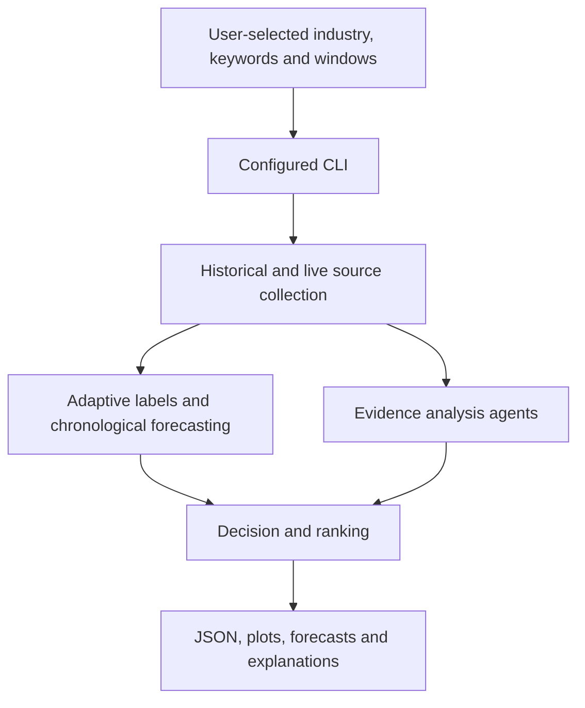
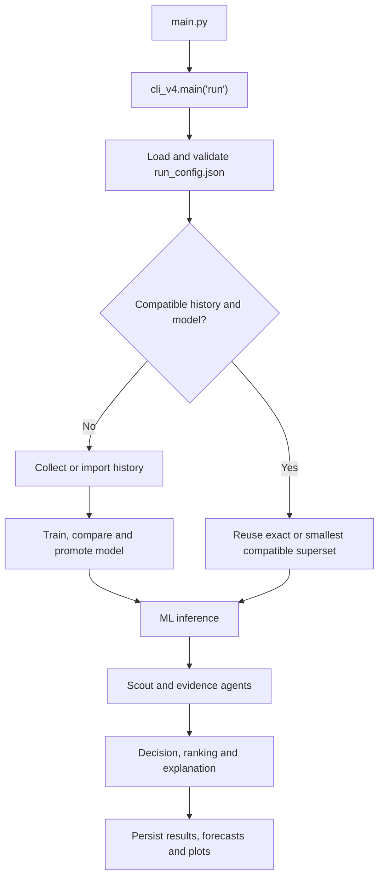
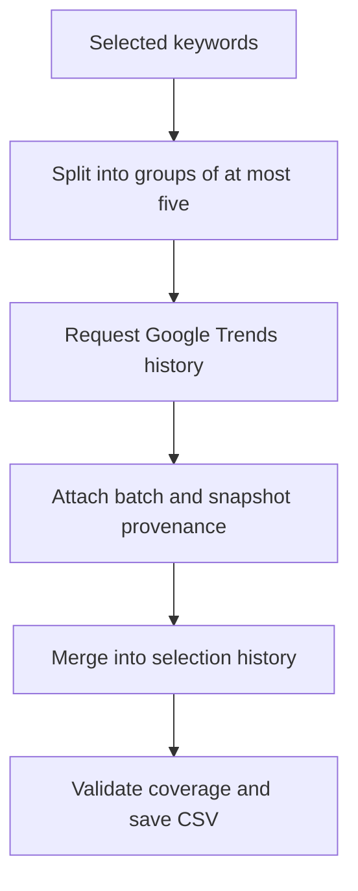
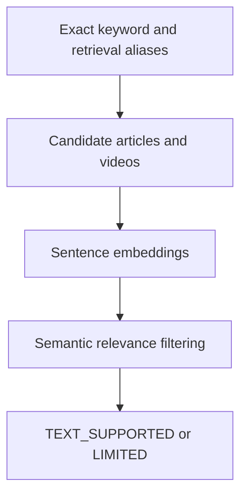
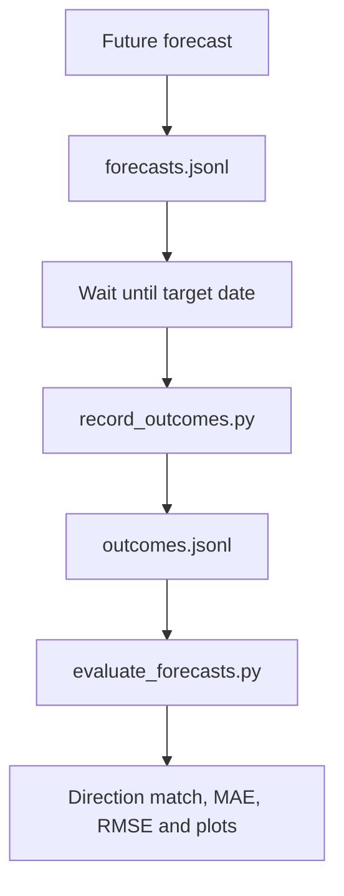

# TrendSense Architecture

## 1. Architecture Purpose

This document explains how the active TrendSense v4 application works, which modules own each responsibility, how data move through the pipeline, and which boundaries must remain intact.

The active command path is:

```text
main.py
  -> cli_v4.py
  -> runtime configuration
  -> prepared history/model resolution
  -> forecast and agent pipeline
  -> stored results, plots and forecast records
```

Older pipeline functions remain in the repository for compatibility and research history. New configurable work must use the v4 path.

## 2. Technology Stack

### Language and runtime

- Python 3.10 or later
- Recorded development runtime: Python 3.13.5

### Data collection

- Requests
- Feedparser
- PyTrends
- YouTube Data API integration
- NewsAPI integration
- Google News RSS

### Data processing

- pandas
- NumPy

### Machine learning

- scikit-learn
- XGBoost as an optional dependency
- LightGBM as an optional experimental dependency
- joblib for persisted model bundles

### NLP

- Sentence Transformers
- PyTorch
- Default semantic model: `sentence-transformers/all-MiniLM-L6-v2`

### Evaluation and visualization

- scikit-learn metrics
- Matplotlib
- JSON, JSONL and CSV artifacts

### Testing

- pytest

## 3. System Context



## 4. Active Runtime Flow



## 5. Agent Pipeline

The configured pipeline is sequential because each stage enriches records required by later stages.

| Order | Stage | Active module | Main responsibility |
|---:|---|---|---|
| 1 | ML Forecaster | `forecast_experiment.py` | Load the promoted model, build live features and predict direction and numeric interest |
| 2 | Scout Source Collector | `agents/scout_agent.py`, `agents/selected_scout.py` | Collect and filter YouTube, RSS, NewsAPI and Google Trends source information |
| 3 | Weak Signal Agent | `agents/weak_signal_agent.py` | Aggregate observed source counts without manual source weights |
| 4 | Lifecycle Agent | `agents/lifecycle_agent.py` | Describe trend phase from measured direction |
| 5 | Authenticity Agent | `agents/authenticity_agent.py` | Report provenance, domains and duplicates without claiming unverified genuineness |
| 6 | Semantic Evidence Agent | `agents/semantic_evidence_agent.py` | Measure semantic relevance of collected text with a Hugging Face model |
| 7 | Evidence Validation Agent | `agents/evidence_validation_agent.py` | Convert semantic availability into explicit evidence states |
| 8 | Industry Impact Agent | `agents/industry_impact_agent.py` | Map trends to applicable industries, categories and business areas |
| 9 | Commercial Validation Agent | `agents/commercial_potential.py` | Report marketplace evidence and explicit commercial-data limitations |
| 10 | Decision and Ranking Agent | `agents/decision_engine.py`, `agents/configured_analysis.py` | Apply validation-gated recommendations and keyword-specific ranking |
| 11 | Explainability Agent | `agents/explainability_engine.py` | Attach reasons, warnings and model information |

`run_agent()` in `cli_v4.py` prints stage start, completion and failure messages.

## 6. Configuration Architecture

`run_config.json` is the default experiment contract.

```json
{
  "industry": "fashion",
  "keywords": {
    "selection_mode": "manual",
    "selected": ["co-ord set", "kurta set"],
    "preset_name": null
  },
  "collection": {
    "country": "IN",
    "language": "en-IN",
    "history_days": 90,
    "batch_size": 5,
    "delay_seconds": 10,
    "max_retries": 3
  },
  "window": {
    "analysis_days": 90,
    "test_days": 14,
    "end_date": "latest_complete",
    "feature_warmup_days": 21
  },
  "forecast": {
    "horizon_days": 2,
    "verification_delay_days": 2
  }
}
```

Runtime command-line options override a copied in-memory configuration. They do not rewrite `run_config.json`.

Validation rules are implemented in `runtime_config.validate_config()`:

- Industry cannot be empty.
- At least one unique keyword is required.
- Positive integer fields must remain positive.
- Google Trends batch size cannot exceed five.
- Test days must be fewer than analysis days.
- At least two validation folds are required.
- Threshold methods must be supported.
- Promotion improvement cannot be negative.

## 7. Keyword Selection Architecture

`keyword_selection.py` owns keyword parsing and normalization.

Supported inputs:

```text
--keywords "glass skin" "lip liner"
--keywords "glass skin,lip liner"
--keywords-file beauty_keywords.txt
--keywords-file beauty_keywords.json
--interactive
--use-config-keywords
```

The module:

- Normalizes Unicode with NFKC.
- Collapses repeated whitespace.
- Removes empty entries.
- Removes case-insensitive duplicates.
- Preserves input order.
- Rejects an empty selection.

`related_suggestions()` provides opt-in Google Trends suggestions. Suggestions never mutate the selection automatically.

## 8. Historical Data Architecture

`agents/historical_data_agent.py` collects or imports history.

### Batch behavior



Each selection has a fingerprint based on:

- Industry
- Ordered selected keywords
- Country
- Batch size

Artifacts are stored under:

```text
data/v4/selections/<selection_id>/
├── history.csv
├── signals.json
└── scout_health.json
```

## 9. Experiment and Model Architecture

An experiment fingerprint is calculated from the effective configuration excluding the root path.

```text
data/v4/experiments/<experiment_id>/
├── comparison.json
├── config.json
├── features.csv
├── model.joblib
├── test_predictions.json
├── forecasts.jsonl
├── outcomes.jsonl
├── final_results_<timestamp>.json
└── plots/
```

### Compatible model reuse

`runtime_config.resolve_prepared()` resolves:

1. An exact selection history and model.
2. Otherwise, the smallest trained superset matching industry, country, horizon, analysis window and warm-up window.

When a superset is reused:

- Inference returns only requested keywords.
- Scout must read the resolved superset history path.
- Source collection still uses only requested keywords.
- The terminal prints a model-reuse message.

## 10. Feature and Label Architecture

`agents/window_features.py` builds the configured time window and past-only features.

Feature families include:

- Current interest
- Lagged interest
- Relative changes
- Rolling means and dispersion
- Relative trend and slope
- Rolling z-score
- Calendar features

No feature may use observations after the forecast origin.

`adaptive_thresholds.py` provides:

- MAD bands
- IQR bands
- Rolling z-score bands
- Percentile bands

Direction uses future change relative to the causal band:

```text
future change > band      -> UP
future change < -band     -> DOWN
otherwise                 -> STABLE
missing or zero band      -> UNKNOWN / UNAVAILABLE
```

## 11. Validation and Training Architecture

`forecast_experiment.py` orchestrates:

1. Window construction
2. Feature and label generation
3. Adaptive threshold comparison
4. Chronological fold creation
5. Hyperparameter and class-weight search
6. Baseline comparison
7. Held-out testing
8. Validation-only model promotion
9. Model and report persistence

`evaluation/time_splits.py` owns chronological split behavior. Training target dates must end before validation origins begin.

`model_registry.py` defines reproducible estimator families and parameter spaces.

Configured final candidates come from `run_config.json`:

- Logistic regression
- Random forest
- SVM
- XGBoost

Baselines:

- Persistence
- Seasonal Naive

The registry also contains optional experimental models. Registry presence does not mean a model was used in a reported experiment.

## 12. Inference Output Contract

A ready forecast contains at least:

```text
keyword
industry
ml_forecast_status
ml_predicted_direction
ml_probabilities
ml_confidence
confidence_type
ml_forecast_method
numeric_model
ml_horizon_days
ml_current_interest
predicted_interest
predicted_change
predicted_growth_percent
numeric_direction
threshold
past_direction
forecast_origin_date
target_date
policy_cutoffs
history_coverage
normalization_provenance
snapshot_id
```

Unavailable forecasts must retain the keyword and include a warning.

## 13. Evidence Architecture

### Exact filtering

`agents/selected_scout.py` ensures that:

- Evidence belongs to a requested keyword.
- Evidence has a usable date.
- Evidence falls inside the selected period.
- Query metadata alone does not become evidence.
- Duplicate URLs are removed.

### Semantic processing

The semantic agent runs after candidate collection because sentence embeddings cannot retrieve documents that were never returned by an external source.



## 14. Decision Architecture

The configured path delegates from `agents/decision_engine.py` to `agents/configured_analysis.py`.

### INVEST gate

All must be true:

- Forecast status is `READY`.
- Target is still in the future.
- Classifier direction is `UP`.
- Numeric direction is `UP`.
- UP score meets the validation-selected UP cutoff.
- Text evidence is valid.

### AVOID gate

The corresponding DOWN conditions must be true.

### WAIT gate

WAIT is issued when any action requirement is missing, including:

- STABLE direction
- Model disagreement
- Score below cutoff
- Missing text evidence
- Historical replay
- Unavailable forecast

### Valid text evidence

```text
TEXT_SUPPORTED
MEDIUM
HIGH
```

### Ranking

Ranking sorts ready rows by:

```text
UP score
numeric change / adaptive threshold
semantic evidence count
total evidence count
keyword as deterministic final tie-breaker
```

The model UP score remains in `ml_probabilities.UP`. The separate `watchlist_score` is a within-run percentile.

## 15. Persistence and Evaluation Architecture

`storage/configured_forecasts.py` owns configured forecast persistence and outcome recording.

Forecast lifecycle:



Evaluation must use the exact target date when available. It must not replace a missing target with the latest observation.

## 16. Folder Structure

```text
TrendSense_integrated/
├── main.py                         # Primary run entry point
├── cli_v4.py                       # Shared configured command interface
├── run_config.json                 # Default experiment configuration
├── runtime_config.py               # Validation, fingerprints and model reuse
├── keyword_selection.py            # Dynamic keyword inputs and suggestions
├── adaptive_thresholds.py          # Causal adaptive label bands
├── forecast_experiment.py          # Training, comparison, promotion and inference
├── model_registry.py               # Model families and search spaces
├── contracts.py                    # Shared typed persistence contracts
├── collect_historical.py           # Historical collection command
├── train_models.py                 # Training command
├── record_outcomes.py              # Outcome recording command
├── evaluate_forecasts.py           # Forecast evaluation command
├── doctor.py                       # Environment and artifact checks
├── agents/
│   ├── historical_data_agent.py
│   ├── scout_agent.py
│   ├── selected_scout.py
│   ├── window_features.py
│   ├── ml_forecasting_agent.py
│   ├── weak_signal_agent.py
│   ├── lifecycle_agent.py
│   ├── authenticity_agent.py
│   ├── semantic_evidence_agent.py
│   ├── evidence_validation_agent.py
│   ├── industry_impact_agent.py
│   ├── commercial_potential.py
│   ├── decision_engine.py
│   ├── configured_analysis.py
│   └── explainability_engine.py
├── evaluation/
│   ├── time_splits.py
│   ├── baselines.py
│   ├── metrics.py
│   ├── plots.py
│   ├── ground_truth.py
│   └── backtest.py
├── storage/
│   ├── configured_forecasts.py
│   ├── forecasts.py
│   └── history.py
├── tests/
├── docs/
├── data/
│   └── v4/
│       ├── selections/
│       └── experiments/
├── requirements.txt
└── requirements-optional.txt
```

Generated `__pycache__`, `.pytest_cache`, experiment artifacts and model binaries are not source modules.

## 17. Command Architecture

### Environment check

```powershell
python doctor.py
```

### Dynamic run with automatic preparation

```powershell
python main.py --industry beauty --keywords "glass skin" "lip liner" --plots
```

### Explicit preparation

```powershell
python main.py --industry beauty --keywords "glass skin" "lip liner" --prepare --plots
```

### Historical collection

```powershell
python collect_historical.py --industry beauty --keywords "glass skin" "lip liner" --refresh
```

### Model training

```powershell
python train_models.py --industry beauty --keywords "glass skin" "lip liner" --plots
```

### Record and evaluate mature forecasts

```powershell
python record_outcomes.py --industry beauty --keywords "glass skin" "lip liner"
python evaluate_forecasts.py --industry beauty --keywords "glass skin" "lip liner" --plots
```

The exact industry, keywords, analysis days, test days and horizon used during record and evaluation must resolve to the same experiment fingerprint as the forecast run.

## 18. Architectural Rules

- `main.py` is the public run command. Configured behavior belongs in `cli_v4.py` and v4 modules.
- Do not add new fixed keyword fallbacks.
- Do not let source-query metadata count as evidence.
- Do not use future values in features, labels, preprocessing or model selection.
- Do not select a model from held-out test performance.
- Do not relabel rank percentiles as probabilities.
- Do not convert semantic relevance into authenticity or profitability.
- Do not make one source failure crash every source unless no usable input remains.
- Do not overwrite usable history before a refresh succeeds.
- Keep collection, modeling, evidence analysis, decisions and presentation separate.
- Every generated artifact must be selection-specific or experiment-specific.
- Legacy modules may be maintained for compatibility, but new work must not bypass the configured v4 path.
