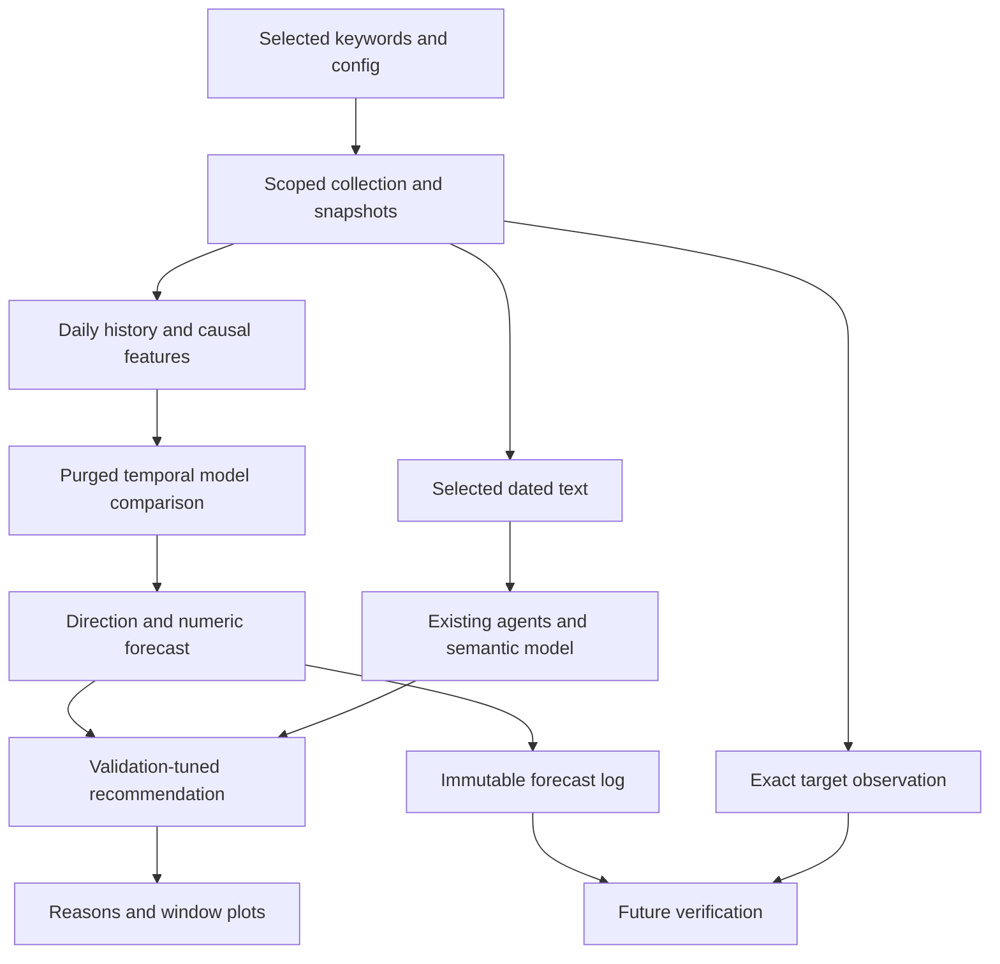
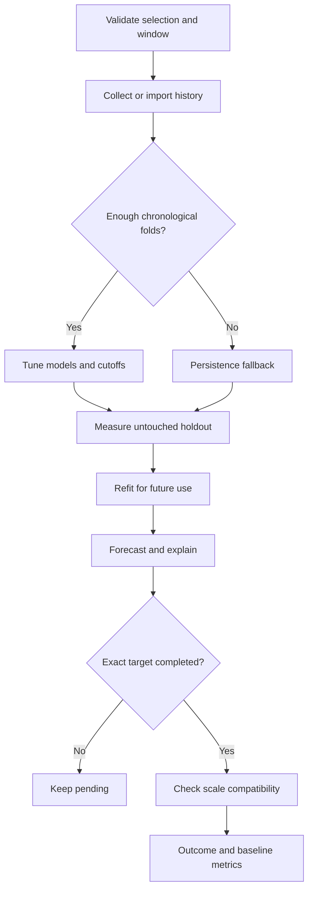

# Implemented changes B–H

Assumption: the target is normalized daily search interest. Articles/videos support current explanations; without historical timestamped snapshots they are not historical predictive features. Commercial recommendations concern investigation, not proven profit.

## File map and execution order

| Stage | Existing files updated | New modules | When used |
|---|---|---|---|
| B | Scout, historical collector, `collect_historical.py` | `runtime_config.py`, `keyword_selection.py`, `agents/selected_scout.py`, `run_config.json` | Selection and collection |
| C | Semantic evidence agent | `adaptive_thresholds.py` | Label creation and semantic evidence |
| D | `doctor.py`, feature engineering agent | `agents/window_features.py` | Coverage checks and features |
| E | `train_models.py`, ML forecasting agent | `model_registry.py`, `forecast_experiment.py`, `evaluation/time_splits.py` | Training and comparison |
| F | `main.py`, `record_outcomes.py`, `evaluate_forecasts.py` | `cli_v4.py`, `storage/configured_forecasts.py`, `evaluation/plots.py` | Forecast issue and verification |
| G | All eight original agent entry points plus evidence validation | `agents/configured_analysis.py` | Each configured run |
| H | `README.md` | This guide, sample audit, regression tests | Report and demonstration |

The original eight remain Scout, Weak Signal, Lifecycle, Authenticity, Industry Impact, Commercial Potential, Decision and Explainability. Existing entry points accept a configuration and dispatch to the updated implementation. Unconfigured legacy functions remain for compatibility; the main CLI always uses the new configuration. Historical, feature, semantic and ML components remain supporting modules.

## B. Dynamic keyword selection

Manual selection accepts any nonempty list size. Whitespace/case-equivalent duplicates are normalized; an empty list fails instead of falling back to 55 terms. Fashion/beauty presets reuse existing lists only when explicitly requested. Other industries use manual terms. Suggestions are opt-in and must be accepted into the config manually.

Every downstream row is restricted to selected keywords. Text must contain a term; query/seed metadata is not evidence. Publication dates must belong to the selected interval. News/video requests also specify dates where supported. Retrieval is not exhaustive; source failures are reported.

Google Trends batches contain at most five terms. Cache identities include the industry, ordered selection, country and batch size. Batch composition is preserved because index normalization depends on the request. Raw index levels from unrelated requests are not absolute demand rankings.

Partial collection failures preserve the previous complete history and record diagnostics. Current-day/partial observations are excluded. Weekly data is rejected instead of interpolated into fictional daily observations.

## C. Adaptive threshold methods

At origin t and horizon h, compute past observed changes `interest(s)-interest(s-h)` for s no later than t. Estimate a rolling scale, then compare the future change `interest(t+h)-interest(t)` with the band calculated at t. Above the band means UP, below its negative means DOWN; otherwise STABLE.

| Method | Band | Benefit | Limitation |
|---|---|---|---|
| Rolling z-score scale | Multiplier × standard deviation of past changes | Simple volatility adaptation | Spikes inflate it; this zero-centered direction band is not a mean-centered anomaly test |
| MAD / IQR | Median absolute deviation with IQR fallback; IQR also selectable | Robust to isolated spikes | Sparse data may have zero scale |
| Percentile | Chosen quantile of absolute past changes | Distribution-light interpretation | Short-window quantiles are unstable |
| Validation-tuned policy | Search directional out-of-fold scores for binary F1 | Replaces fixed invest/avoid cutoffs | Needs class examples; does not optimize profit |

Recommendation: **MAD labels plus validation-tuned action cutoffs**. Quiet and volatile keywords no longer share +3/-3 boundaries. Zero MAD and IQR produce UNKNOWN/abstention, not an invented epsilon.

Lookback, multiplier, percentile and optimization metric remain explicit modeling choices recorded in reports. Adaptive does not mean assumption-free. The search tunes model parameters and action cutoffs, not the label definition. Changing labels just to improve accuracy creates a moving target; assess threshold sensitivity as development experiments and reserve fresh final data.

The existing MiniLM semantic model still embeds text/keywords for cosine matching. The configured path derives a per-keyword candidate threshold from the similarity distribution instead of a fixed cosine cutoff. This is uncalibrated relevance evidence, not proof of truth. Current text is never attached retroactively to historical training rows.

## D. Diagnosis and fixes

| Risk | Implemented correction |
|---|---|
| Noisy universal labels | Per-keyword causal bands and explicit UNKNOWN cases |
| Class imbalance | Macro-F1, balanced accuracy, per-class support/precision/recall; class-weight options where supported |
| Target overlap leakage | Train target dates must precede validation/test origin dates |
| Same day scattered across folds | Split unique dates first, then map all keyword rows |
| Missing dates treated as adjacent | Daily calendar reindexing; no zero-fill or target interpolation |
| Preprocessing leakage | Scalers inside pipelines fitted within each fold |
| Too little history | Coverage warnings and persistence fallback when tuning is infeasible |
| Weak features | Past lags, means/std, momentum and weekday encoding |
| Unsupported business claims | Missing evidence and authenticity/profit labels remain explicitly unverified |
| Wrong verification date | Exact target only; otherwise pending |
| Revised normalized history | Preserve snapshots; compatible batches and labeled approximate rebasing |

More keywords add rows, not independent time periods. Ten days cannot establish reliable performance of six complex models. Demonstrate small-window fallback but use a longer window for substantive evaluation.

## E. Model architectures and tuning

There are two supervised outputs: three-class direction and numeric change. Future interest equals current interest plus predicted change, floored at zero. No arbitrary cap at 100 is applied to a future reference-scale prediction.

| Family | Classifier | Regressor |
|---|---|---|
| Linear | StandardScaler → LogisticRegression | StandardScaler → Ridge |
| Random Forest | RandomForestClassifier | RandomForestRegressor |
| Gradient Boosting | GradientBoostingClassifier | GradientBoostingRegressor |
| SVM | StandardScaler → SVC | StandardScaler → SVR |
| XGBoost, optional | XGBClassifier | XGBRegressor |
| LightGBM, optional | LGBMClassifier | LGBMRegressor |
| Persistence | STABLE | Last observed interest |
| Seasonal naive | Direction of seasonal prediction | Most recent observed value on target weekday |

`ParameterSampler` supplies a small configurable search. Each trial uses expanding `TimeSeriesSplit` folds on unique dates and purges overlapping targets. Missing optional libraries/trial failures are reported. SVM uses margin-derived normalized scores, avoiding shuffled internal probability calibration.

Select direction by validation macro-F1 and numeric predictions by validation MAE independently. Baselines may win. Measure every candidate on the same held-out data, recording accuracy, macro-F1, per-class metrics, confusion matrix, MAE and RMSE. Only afterward refit selected models on all mature observations for future use.

Validation results are selection scores, not unbiased final performance. Using the same out-of-fold predictions to tune action thresholds can overfit validation; the untouched test remains the assessment. Repeatedly inspecting that test while changing settings makes it development data and requires a new final holdout.

## F. Windows and future comparison

`analysis_days=40`, `test_days=10` creates 30 nominal train days and 10 test-origin days. A 2-day horizon purges training origins whose targets enter testing. The last two test origins do not yet have mature targets and cannot be scored. Warmup days before the visible window initialize features without becoming training origins.

Evaluation is **rolling-origin**: a test prediction may use observations already known on its origin date, while its model was fitted only on pre-test targets. This does not claim to predict an entire ten-day trajectory at once from day 30. That needs separate horizon-specific models/evaluation.

Professor's 30/10/2 timeline: use 40/10 for a historical 30-train/10-holdout demo. Prospectively, issue recommendations on each of ten days and verify each 2-day target once complete. Ten recommendation days cannot be compressed into two real days. For a five-day deadline, show historical holdout plots plus a smaller labeled prospective sample. A 10-day-ahead forecast needs horizon_days=10 and cannot be verified after two days.

Plots show selected keywords and the selected observed interval, plus a marked future target when supplied. Holdout plots compare actuals, forecasts and persistence. Future verification plots require real outcomes. JSON includes past/predicted directions, growth (undefined if current interest is zero), confidence type and reasons. Residual standard deviation is not a coverage-guaranteed prediction interval.

Forecast logs preserve issue time, exact target, original threshold, model version, snapshot and batch. Verification waits for both a complete target day and the configured check delay. A refreshed Google snapshot may rescale/revise history; optional overlap-median rebasing is approximate, labeled separately, with alignment MAE. Strict snapshot-only verification can leave outcomes pending.

## G. Recommendations

Configured runs remove weighted source/agent scores and fixed invest/wait/avoid probabilities. UP/DOWN cutoffs maximize binary F1 on chronological out-of-fold scores; stricter cutoffs win ties. If a direction lacks validation examples, that action is disabled. Baselines have no learned action cutoffs and remain WAIT.

INVEST requires UP from both classifier and numeric forecast, score above the learned cutoff, and semantic support when required. It means a candidate for a limited trial. AVOID uses corresponding DOWN criteria. Stable, unsupported, conflicting, incomplete or already-observed cases yield WAIT. Ranking uses only the UP score. Scores are uncalibrated and not probabilities of profit.

Lifecycle describes observed growth/stability/decline. Authenticity reports provenance and UNVERIFIED rather than an invented bot probability. Commercial metadata cannot establish sales, margins or ROI. These are explicit eligibility rules surrounding learned forecasts; the project does not claim every component is learned.

## H. Report and demo

Place this schematic in **System Architecture**, after the problem/objectives:

Place this flowchart in **Methodology**, before training/evaluation details:

| Objective | Evidence to present |
|---|---|
| Variable keywords | Config and selected-only output/cache identity |
| Adaptive cutoffs | Different per-keyword bands and stored action cutoffs |
| Other models and tuning | Comparison report, folds and model plot |
| Dynamic window | Change analysis_days and inspect window plots |
| Temporal holdout | Test start, purged dates and confusion matrix |
| Future versus past | Exact-date outcomes, growth/direction, MAE/RMSE and reasons |

Demo order: configuration → coverage → baseline comparison → window plot → individual reasons → prospective evaluation or explicitly pending status. Successful execution is not proof of accurate forecasts.

## References

- [scikit-learn TimeSeriesSplit](https://scikit-learn.org/stable/modules/generated/sklearn.model_selection.TimeSeriesSplit.html)
- [scikit-learn cross-validation](https://scikit-learn.org/stable/modules/cross_validation.html)
- [MiniLM model card](https://huggingface.co/sentence-transformers/all-MiniLM-L6-v2)

Date grouping, target purging, adaptive labels and outcome rules are project implementation choices built around these tools.
